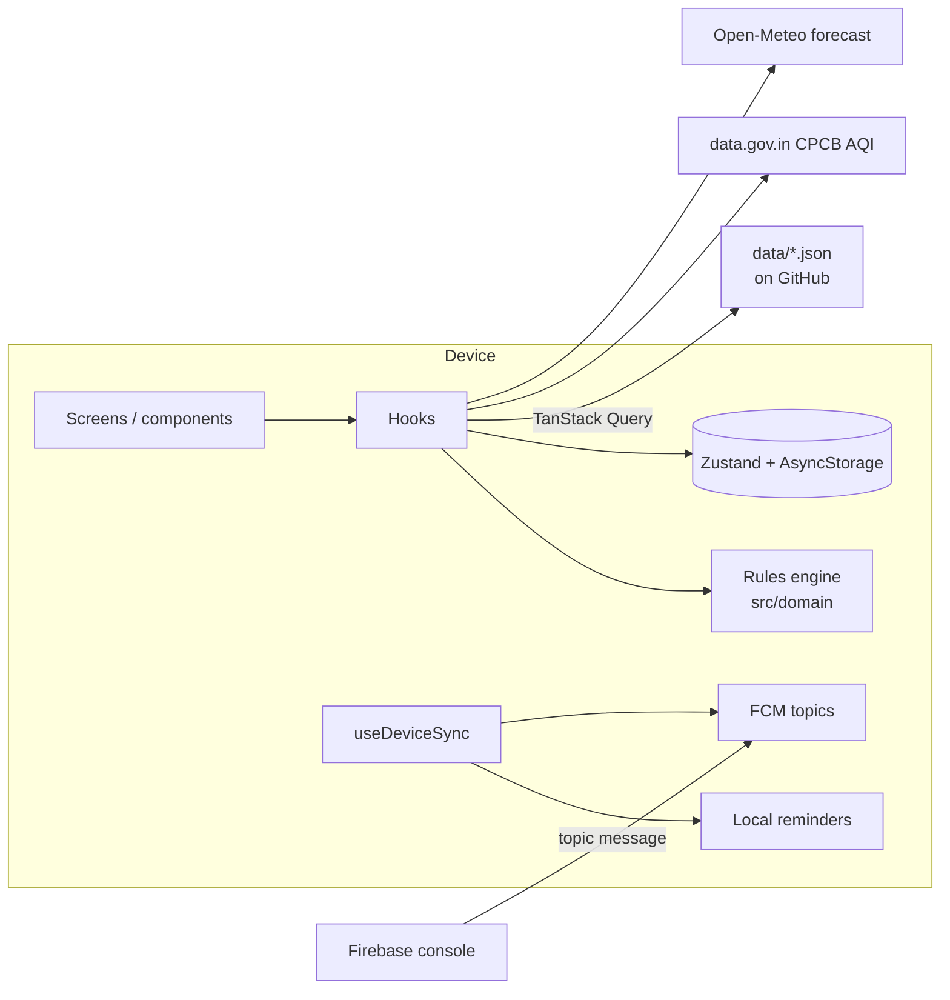

<p align="center">
  
</p>

<p align="center"><strong>Know before you drive.</strong><br/>
Today's GRAP verdict for your exact vehicle across Delhi-NCR — district by district, every morning.</p>

<p align="center">
  <a href="https://gaadicheck.expo.app">Website</a> ·
  <a href="https://gaadicheck.expo.app/app/">Web app</a> ·
  <a href="https://github.com/Austin2501/GaadiCheck/releases/latest/download/GaadiCheck.apk">Download APK</a> ·
  <a href="docs/README.md">Documentation</a>
</p>

---

Delhi-NCR's Graded Response Action Plan (GRAP) switches anti-pollution curbs on and off at short notice, and whether a vehicle may be driven depends on its fuel, BS norm, registration state and the current stage. Cameras now issue challans automatically. GaadiCheck turns all of that into a single, explainable answer for each vehicle you own.

## Features

|                              |                                                                                                                                                                     |
| ---------------------------- | ------------------------------------------------------------------------------------------------------------------------------------------------------------------- |
| **Personal verdict**         | Allowed / not allowed / check for each of Delhi, Gurugram, Faridabad, Ghaziabad, Gautam Buddh Nagar and Sonipat, with the reason, the fine and a link to the order  |
| **Data-driven rules engine** | GRAP restrictions live in `data/rules.json`; tri-state evaluation asks for missing details instead of guessing                                                      |
| **Live GRAP stage**          | Fetched from a JSON feed, cached for offline use, with a bundled fallback                                                                                           |
| **Air quality**              | Official CPCB station AQI (data.gov.in) with Open-Meteo forecasts converted to India's AQI scale; tomorrow's outlook and the stage it implies                       |
| **Document reminders**       | Local notifications 7 days and 1 day before PUC and insurance expire; first-year PUC cover and end-of-life age checks                                               |
| **Stage-change alerts**      | _Coming soon._ FCM topic subscriptions derived from the rules each vehicle could fall under — no server, no personal data. Switches on once Firebase is configured. |
| **RC / PUC scanning**        | On-device OCR (ML Kit / Apple Vision) fills fuel, BS norm, registration date and PUC expiry from a screenshot                                                       |
| **Smart defaults**           | Plate parsing (incl. Bharat series), home district from RTO code or location, BS-norm suggestion from registration date                                             |
| **Share card**               | Branded 4:5 status image with a ready-to-paste caption                                                                                                              |
| **Bilingual**                | Every screen, reminder and alert in English and Hindi                                                                                                               |
| **Accessible**               | Status is always icon + text + colour, 48 dp targets, screen-reader labels, dynamic type                                                                            |

## Tech stack

| Area          | Choice                                                                                          |
| ------------- | ----------------------------------------------------------------------------------------------- |
| App           | Expo SDK 58 · React Native 0.88 · TypeScript (strict)                                           |
| Navigation    | Expo Router (file-based, typed params)                                                          |
| State         | Zustand + AsyncStorage persistence                                                              |
| Server state  | TanStack Query with an AsyncStorage persister                                                   |
| Forms         | React Hook Form + Zod                                                                           |
| i18n          | i18next / react-i18next with typed keys                                                         |
| Notifications | expo-notifications (local) · React Native Firebase Messaging (topics)                           |
| Device        | expo-location · expo-image-picker · expo-text-extractor · react-native-view-shot · expo-sharing |
| Analytics     | PostHog (optional, anonymous)                                                                   |
| Quality       | Jest (jest-expo) · ESLint (expo config) · Prettier                                              |

Everything used is open source or free; there are no paid APIs.

## Architecture



- **`src/domain`** is pure TypeScript with no React or Expo imports: zones, plate parsing, BS-norm timelines, the rules engine, document checks, India's AQI calculation and the OCR text parsers. It is fully unit-tested.
- **`src/services`** wraps the outside world (network, notifications, Firebase, OCR, location, sharing) and degrades gracefully when a native module, key or permission is missing.
- **`src/hooks`** connects the two for the UI; **`app/`** holds the screens.

```
app/                    Expo Router screens
  (tabs)/               Today · Air · Vehicles · More
  onboarding/           Welcome · notification permission
  vehicle/              Add · edit
  share.tsx guide.tsx sources.tsx
src/
  domain/               Pure business logic + tests
  services/             Network, notifications, alerts, OCR, location, share, analytics
  hooks/                Queries, assessment, device sync
  features/             Feature components (today, air, vehicles, share)
  components/           Design system (ui/) and brand components
  store/                Persisted Zustand stores
  i18n/                 English and Hindi resources, formatting
  theme/                Colour, type, spacing tokens
data/                   GRAP stage + rule book (bundled and served remotely)
plugins/                Expo config plugins for native build settings
brand/                  Logo files, brand guide, brand kit PDF, fonts
landing/                Static landing page
```

## Getting started

**Prerequisites:** Node 20+, JDK 17, Android Studio with an emulator or a physical Android device (USB debugging on).

```bash
npm install
cp .env.example .env      # all values optional
npx expo run:android      # builds and installs a development build
```

Subsequent runs only need `npm start`. For the web version, run `npm run start:web`. To try the app without a native build, install Expo Go on the phone and run `npm run start:go`; everything except document scanning and stage alerts works there, since those two need native modules.

### Environment

| Variable                            | Purpose                                                                                                                                                               |
| ----------------------------------- | --------------------------------------------------------------------------------------------------------------------------------------------------------------------- |
| `EXPO_PUBLIC_DATA_BASE_URL`         | Base URL serving `grap-status.json` and `rules.json` — e.g. `https://raw.githubusercontent.com/<user>/gaadicheck/main/data`. Without it the bundled snapshot is used. |
| `EXPO_PUBLIC_DATA_GOV_API_KEY`      | Free key from [data.gov.in](https://data.gov.in) for official CPCB AQI. Without it AQI is labelled _Estimated_.                                                       |
| `EXPO_PUBLIC_POSTHOG_KEY` / `_HOST` | Optional anonymous analytics.                                                                                                                                         |
| `EAS_OWNER`, `EAS_PROJECT_ID`       | Only needed to build under a different Expo account; `app.config.ts` already holds this project's IDs.                                                                |

`EXPO_PUBLIC_*` values are compiled into the app, so only use read-only keys there.

## Operating the app

### Updating the GRAP stage

1. Edit `data/grap-status.json` (`stage`, `effectiveFrom`, `orderUrl`, `note`, `updatedAt`) from the latest CAQM order.
2. Commit and push. Devices pick it up on their next refresh (every 10–30 minutes, or on pull-to-refresh).
3. Optionally notify affected users (below).

### Changing rules

Rules are data. Each entry in `data/rules.json` lists the districts, conditions (`vehicleTypes`, `fuels`, `maxBsNorm`, `registeredInDelhi`, `minStage`, `validFrom`/`validUntil`, `exceptWeekdays`, `oddEven`, `exemptEssentialServices`), severity, fine, alert topic and bilingual copy. Increase `version` when you publish changes, add a test in `src/domain/__tests__/rulesEngine.test.ts`, and run `npm test`. Both files are validated with Zod at runtime, so a malformed feed is rejected and the app keeps its cached copy. With `EXPO_PUBLIC_DATA_BASE_URL` set, a pushed rule reaches installed apps without a new build.

**Odd-even rationing.** `oddEven: true` restricts vehicles whose registration number ends in a digit of the opposite parity to the date (the last digit before the series letters on BH plates). Past schemes covered private cars only, ran 8 AM–8 PM and skipped Sundays; the hours are not modelled, so state them in the explanation. A scheme announced for a week would look like:

```json
{
  "id": "delhi-odd-even",
  "zones": ["delhi"],
  "conditions": {
    "vehicleTypes": ["car"],
    "fuels": ["petrol", "diesel"],
    "oddEven": true,
    "exceptWeekdays": [0],
    "validFrom": "2026-12-01",
    "validUntil": "2026-12-07",
    "exemptEssentialServices": true
  },
  "severity": "blocked",
  "fineInr": null,
  "alertTopic": "rule-odd-even",
  "title": { "en": "Odd-even in force", "hi": "ऑड-ईवन लागू" },
  "explanation": {
    "en": "8 AM–8 PM, except Sundays: plates ending in an odd digit on odd dates, even on even dates. Electric and CNG cars are exempt.",
    "hi": "सुबह 8 से रात 8 बजे तक, रविवार को छोड़कर: विषम अंक पर ख़त्म होने वाले नंबर विषम तारीख़ों पर, सम अंक वाले सम तारीख़ों पर। इलेक्ट्रिक और सीएनजी कारों को छूट है।"
  },
  "sourceUrl": "https://transport.delhi.gov.in"
}
```

Take the dates, hours, fine (`fineInr`) and exemptions from the official order before publishing.

### Stage-change alerts (optional, free)

1. Create a Firebase project and add an Android app with package `com.gaadicheck.app` (development builds use `com.gaadicheck.app.dev`).
2. Download `google-services.json` to the project root (it is git-ignored). For EAS cloud builds, add it in the Expo dashboard as a **file** environment variable named `GOOGLE_SERVICES_JSON`.
3. Rebuild. The app config adds the Firebase plugins only when the file is present.
4. Devices subscribe to `ncr-all`, `zone-<district>` and one topic per rule that could restrict them (`rule-grap3`, `rule-delhi-entry`, `rule-goods`).
5. To alert users, send a notification from **Firebase console → Messaging** to the relevant topic — e.g. `rule-grap3` when Stage III is invoked.

## Building and releasing

See [docs/releasing.md](docs/releasing.md) for over-the-air updates, GitHub Releases and the website (`npm run deploy:web`). The short version for an APK:

```bash
npm install -g eas-cli
eas login                       # the EAS project is already linked in app.config.ts
npm run build:apk               # cloud build (EAS free tier)
npm run build:apk:local         # or build on your machine
```

Publish the APK on GitHub Releases and link it from the landing page. JavaScript-only fixes can be shipped to installed apps with `eas update --channel preview`.

## Quality

```bash
npm run validate     # typecheck + lint + tests
```

The domain layer has unit tests for every GRAP rule, document state, AQI breakpoints, plate formats, BS-norm timelines, OCR parsing and the CPCB / Open-Meteo summaries.

## Data sources and licences

| Data                     | Source                                                | Licence                              |
| ------------------------ | ----------------------------------------------------- | ------------------------------------ |
| GRAP schedule and orders | Commission for Air Quality Management                 | Public orders                        |
| Real-time AQI            | Central Pollution Control Board via data.gov.in       | Government Open Data Licence – India |
| Air quality forecast     | Open-Meteo (Copernicus Atmosphere Monitoring Service) | CC BY 4.0                            |
| Fonts                    | Plus Jakarta Sans, Inter, Noto Sans Devanagari        | SIL Open Font License                |
| Icons                    | Ionicons                                              | MIT                                  |

## Privacy

Vehicle details are stored only on the device. Document images are processed on the device and discarded. Alert subscriptions use anonymous topics; registration numbers are never sent anywhere. Location is used once, on request, to choose the nearest district.

## Known limitations

- The GRAP stage is updated manually from CAQM orders; there is no official machine-readable feed.
- Goods-vehicle restrictions are flagged for a manual check rather than evaluated in detail.
- Open-Meteo estimates come from a regional model and are labelled as such; CPCB readings take precedence.
- iOS builds require an Apple Developer account for distribution and push notifications.

## Disclaimer

GaadiCheck is an independent project and is not affiliated with CAQM, CPCB, the Ministry of Road Transport & Highways or any government body. Verdicts are guidance based on the published GRAP schedule and the details entered by the user. Always follow the latest official orders and instructions from traffic police.
