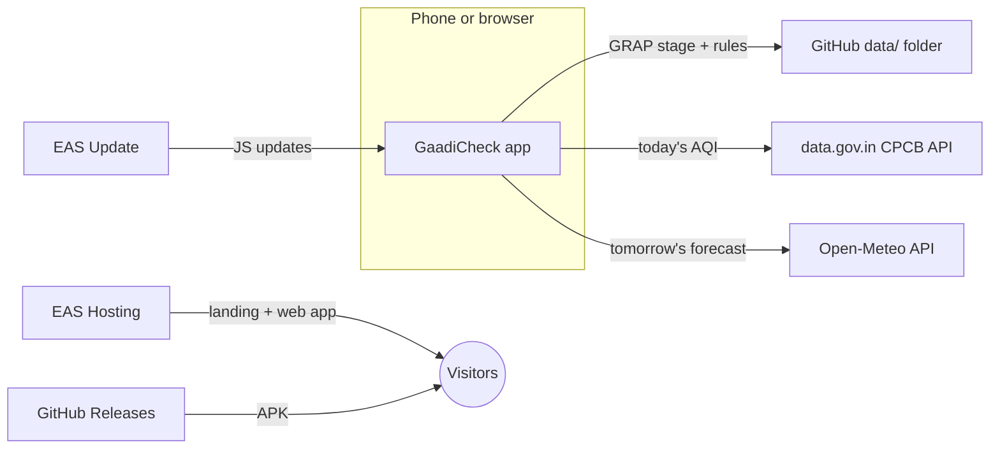

# GaadiCheck documentation

The project handbook: how GaadiCheck is put together, how to run and change it, and how to ship it. Start with the [main README](../README.md) for what the app does and how the code is organised.

| Guide                                                                                              | Read it when you want to…                                                                                         |
| -------------------------------------------------------------------------------------------------- | ----------------------------------------------------------------------------------------------------------------- |
| [Development](development.md)                                                                      | Set up the project, run it on a phone or in the browser, and follow the code conventions                          |
| [Data and rules](data-and-rules.md)                                                                | Change the GRAP stage, add or edit a rule (including odd-even), or understand where air-quality numbers come from |
| [Releasing](releasing.md)                                                                          | Build an APK, publish it on GitHub, push an over-the-air update, or deploy the website                            |
| [Troubleshooting](troubleshooting.md)                                                              | Fix a problem you've hit before: the phone won't connect, AQI shows "Estimated", an update doesn't appear         |
| [Tools and technologies](tools-and-technologies.md) ([PDF](GaadiCheck-Tools-and-Technologies.pdf)) | See every AI tool, framework, library, API and dataset the project uses                                           |

## At a glance

|                  |                                                                                                               |
| ---------------- | ------------------------------------------------------------------------------------------------------------- |
| **Platforms**    | Android app (APK) and a web app, both built from one Expo codebase                                            |
| **Website**      | https://gaadicheck.expo.app (landing page) · https://gaadicheck.expo.app/app/ (web app)                       |
| **APK download** | https://github.com/Austin2501/GaadiCheck/releases/latest/download/GaadiCheck.apk                              |
| **Expo project** | `vineet2501/gaadicheck`                                                                                       |
| **Data feed**    | `data/` on the `main` branch, served from `https://raw.githubusercontent.com/Austin2501/GaadiCheck/main/data` |
| **Backend**      | None. Vehicle details stay on the device; public data comes from GitHub, data.gov.in and Open-Meteo.          |

## How the pieces connect

- **Editing `data/` and pushing to `main`** changes what every installed app shows, without a build.
- **`eas update`** changes the app's code on installed APKs, without a reinstall.
- **`npm run build:apk`** is only needed for native changes (new native package, permissions, icon, app version).
- **`npm run deploy:web`** publishes the landing page and web app.
